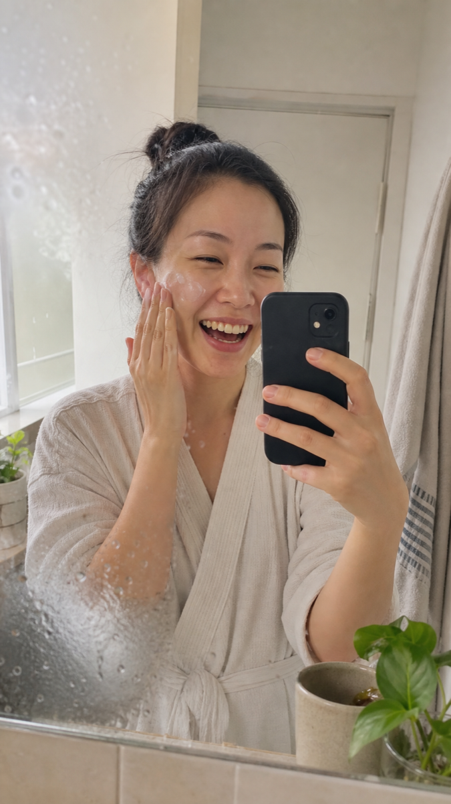
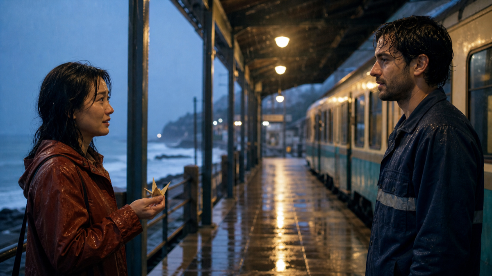
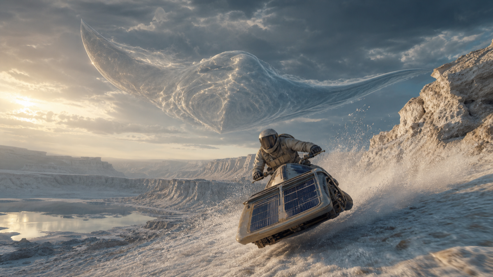

<div align="center">


# Awesome Kling 4.0 Prompts

### 52 original, production-ready Kling AI video prompt recipes with 15-language project guides

[](https://awesome.re)
[](LICENSE)
[](prompts/README.md)
[](#full-prompt-library)
[](docs/LANGUAGES.md)
[](#model-status-and-compatibility)
[](https://github.com/flaqai/awesome-kling-4-0/pulls)

**English** · [简体中文](README.zh-CN.md) · [繁體中文](README.zh-TW.md) · [日本語](README.ja-JP.md) · [한국어](README.ko-KR.md) · [Español](README.es-ES.md) · [Français](README.fr-FR.md) · [Deutsch](README.de-DE.md) · [All 15 languages](docs/LANGUAGES.md)

| [Browse 52 prompts](prompts/README.md) | [Submit an original prompt](https://github.com/flaqai/awesome-kling-4-0/issues/new?template=prompt.yml) | [Request a missing scenario](https://github.com/flaqai/awesome-kling-4-0/issues/new?template=request.yml) | [Contribution guide](CONTRIBUTING.md) | [Create with FLAQ.AI](#about-flaqai) |
|---|---|---|---|---|

</div>

> [!IMPORTANT]
> **Model status — 29 September 2026:** **Kling 4.0 Flash opened for early access on 28 September** for Kling Ultra Yearly subscribers. Kling AI says the broader **Kling 4.0 release and API access are coming in October 2026**; it has not given a day. The announced full 4.0 model supports **up to 30 seconds in one generation**. That 30-second figure describes the forthcoming full model, not a verified limit for today's Flash access. See the [official Kling AI announcement](https://sg.linkedin.com/company/kling-ai-api) and [release notes](https://kling.ai/release-note/release-notes/Kling_4?type=dialog).

An original, production-oriented library of complete Kling AI video prompts for **text-to-video, image-to-video, start/end frames, element references, multi-shot direction, native audio, motion transfer, video editing and extension**. Use copy-ready recipes for cinematic stories, vertical short drama, viral social hooks, product ads, motion graphics, multi-photo transitions, livestream commerce, UGC, multilingual dialogue, automotive, industrial, VFX, animation, sound-led craft, games, education, green-screen plates and previsualization.

## Find the right prompt in under a minute

| If you need… | Start here |
|---|---|
| One complete prompt to customize | [52-prompt master index](prompts/README.md) |
| Film dialogue or emotional performance | [Cinematic & dialogue prompts](prompts/cinematic-and-dialogue.md) |
| Product, e-commerce, UGC or local-business content | [Commercial & UGC prompts](prompts/commercial-and-ugc.md) |
| Sports movement, pursuit, transformation or spectacle | [Action & VFX prompts](prompts/action-and-vfx.md) |
| Animation, fashion, music or dance | [Style & performance prompts](prompts/style-and-performance.md) |
| Food, travel, architecture or craft | [Food, travel & spaces prompts](prompts/food-travel-spaces.md) |
| Education, documentary, loops or social impact | [Education, documentary & social prompts](prompts/education-documentary-social.md) |
| Match cuts, multi-reference, motion transfer or video revision | [Reference, editing & control prompts](prompts/reference-editing-and-control.md) |
| Livestream, gadgets, automotive or manufacturing | [Commerce, tech, mobility & industrial prompts](prompts/commerce-tech-mobility-industrial.md) |
| Presenters, digital humans, pets or supervised learning | [People, pets, learning & culture prompts](prompts/people-pets-learning-culture.md) |
| Games, astronomy, green screen or previsualization | [Gaming, nature & production-tool prompts](prompts/gaming-nature-and-production-tools.md) |
| Vertical drama, dialogue comedy or viral social hooks | [Short drama & viral social prompts](prompts/short-drama-and-viral-social.md) |
| Motion graphics, multi-photo transitions or scale reveals | [Motion graphics & transition prompts](prompts/motion-graphics-and-transitions.md) |
| Closed-course racing, mechanical animation or sound-led craft | [Genre action & sound-sync prompts](prompts/genre-action-and-sound.md) |
| Better timing, camera, continuity, audio or constraints | [Advanced prompting guide](docs/PROMPT-GUIDE.md) |
| Dialogue, pronunciation and mixed-language scenes | [Multilingual audio guide](docs/MULTILINGUAL-AUDIO.md) |
| Guidance in another language | [15-language directory](docs/LANGUAGES.md) |
| Recent Kling 4.0 Flash videos and shared prompts on X | [Flash demo and prompt watchlist](#kling-40-flash-x-demos-and-prompt-lessons) |
| Browser testing or an API-oriented workflow | [FLAQ.AI workflow guide](docs/FLAQ-AI.md) |

## What is included

- **52 complete prompts, not one-line fragments:** each includes mode, anchors, world geometry, timed direction, performance, sound and failure constraints.
- **Thirteen production collections:** film, dialogue, reference control, editing, product, livestream, UGC, automotive, industrial, action, VFX, animation, vertical drama, viral social, motion graphics, transitions, sound sync, food, travel, learning, pets, games and reusable production plates.
- **Four control strategies:** text-led discovery, image-to-video, start/end-frame transitions and element/reference consistency.
- **Five documented Kling 3.0 native-dialogue languages:** Chinese, English, Japanese, Korean and Spanish, including mixed-language examples; full 4.0 promises broader language support.
- **15 project languages:** localized navigation and quick-start guidance, with a transparent distinction between documentation and model speech support.
- **Five original visual assets:** every local image was generated for this repository and documented in the [asset manifest](assets/images/README.md).
- **Production guidance:** aspect-ratio planning, camera geography, reference ownership, audio timelines, iteration logs, rights review and pre-publish checks.
- **Flash creator watchlist:** six linked X examples, their practical prompt lessons and one original quick-start exercise.
- **FLAQ.AI workflow notes:** browser and API routes for currently available Kling 3.0 text-to-video and image-to-video models.

## Model status and compatibility

Kling 4.0 has been announced. The currently accessible Flash variant and the planned full release have different availability, so use the model actually selected in your account when adapting a recipe.

| Item | Verified status | Repository policy |
|---|---|---|
| Kling 4.0 Flash | **Early access opened 28 September 2026** for Ultra Yearly subscribers | Test the available controls in your account; do not assume full 4.0 limits apply to Flash |
| Full Kling 4.0 | **Announced for October 2026**; exact day not published | Treat announced features as planned until the full model is available for testing |
| Single-generation duration | Video 3.0: up to **15 seconds**; full 4.0: **up to 30 seconds announced** | The 52 existing prompt timelines remain 5–15 seconds; extend beats only when your selected model supports longer clips |
| Multi-keyframe / reference control | Full 4.0 announcement: up to **10 keyframes** and **15 multimodal references** | Assign each reference and keyframe a distinct job; confirm these controls in the live mode |
| Full 4.0 image and sound | Up to **4K / 10-bit HDR**, stereo audio and improved lip sync announced | Output options may arrive by mode or tier; verify the generation settings |
| Kling 3.0 video output | Official guide lists 720p/1080p modes; Kuaishou reported **native 4K rollout** on 2026-08-19 | Record the model, provider, mode and date used; availability may vary |
| Multi-shot | Automatic and custom multi-shot documented | Shots declare time, frame, action and camera path |
| Identity / element consistency | Start frame + bound subject / element reference documented | Named continuity anchors are repeated across shots |
| Native audio | Dialogue, ambience and effects | Audio is assigned per speaker and timed beat |
| Kling 3.0 verified dialogue languages | Chinese, English, Japanese, Korean and Spanish | Full 4.0 announces broader language, accent and dialect support; test the selected mode |
| 3+ character dialogue | Multi-character coreference documented | Group scenes fix speaker, seat, wardrobe and order |
| Text preservation | Improved preservation of source-image text documented | Approved packaging should be supplied as a reference and checked frame by frame |
| Official Kling API | Kling AI says **4.0 API access is coming in October** | No 4.0 API model ID, price or request schema is asserted here |
| FLAQ.AI availability | Kling 3.0 workflows are available; FLAQ.AI's 4.0 text/image-to-video pages say **Coming Soon** | A model listing is not an active 4.0 generation endpoint |

Sources checked 29 September 2026: [Kling AI's 4.0 announcement](https://sg.linkedin.com/company/kling-ai-api), [Kling 4.0 release notes](https://kling.ai/release-note/release-notes/Kling_4?type=dialog), [official Kling Video 3.0 guide](https://app.klingai.com/cn/quickstart/klingai-video-3-model-user-guide), [Kuaishou's 3.0 native 4K update](https://ir.kuaishou.com/news-releases/news-release-details/kuaishou-technology-announces-second-quarter-and-interim-2026), and the [FLAQ.AI workflow guide](docs/FLAQ-AI.md).

## Kling 4.0 Flash: X demos and prompt lessons

Checked on **29 September 2026**. The [official Kling AI X launch video](https://x.com/Kling_ai/status/2104596718067257458) introduces the 4.0 family and Flash early access; its promotional montage is **not** evidence that Flash generates a 1:54 clip in one pass. The community posts below are creator-described tests, not official benchmarks or independently verified generation records. Watch the original videos and credit their creators; this repository does not copy their footage or full prompts.

| Creator's X post | What was shared | Useful prompt experiment |
|---|---|---|
| [Umesh: nighttime cat chase](https://x.com/umesh_ai/status/2104595267794460949) · [shared prompt](https://x.com/umesh_ai/status/2104595270671724936) | A creator-labeled 20-second continuous handheld chase through several spaces | Name one subject, a connected route and one physical event per location; ask for a continuous camera path rather than disconnected scenes. |
| [OscarAI: anime concert](https://x.com/Artedeingenio/status/2104829034299351079) | A 20-second Flash video with its prompt; the creator reports better early results from a shorter, direct brief, while noting imperfect adherence | Test a concise sequence of subject → change → camera → ending before adding decorative detail. |
| [とすくん: weather-shift film](https://x.com/tokyo_Valentine/status/2104810060811833710) · [shared prompt](https://x.com/tokyo_Valentine/status/2104810064750239987) | A 15-second reference-led character video and a detailed shot-by-shot prompt | Separate the character sheet's identity role from the scene; state when weather, light and performance change. |
| [Alexandra Dekimpe: production tests](https://x.com/HadesDesign/status/2104878440889417957) | An article with embedded Flash clips covering acting, action, multi-shot direction and references | Replace abstract emotion with visible micro-actions; gate cause and effect with “only after”; provide exact dialogue or request silence. These are the creator's observations, not guaranteed model behavior. |
| [Aswin Aji Raj: Hindi skincare UGC](https://x.com/Aswin_Aji_Raj/status/2104867308514779222) | A creator-labeled 20-second UGC video with Hindi dialogue; the prompt text is not published there | For multilingual tests, specify the speaker and exact line, then review pronunciation, lip sync and any product claims. |
| [@plasm0: 3.0 vs Flash comparison](https://x.com/plasm0/status/2104597949485629557) | Two 10-second clips the creator says used the same prompt | Re-run a fixed brief and reference set across model modes; compare motion, shadows, identity and prompt adherence without treating one pair as a benchmark. |

**An original Flash-oriented starter prompt (15 seconds, 9:16):** This is a new, untested exercise outside the 52-prompt catalog, inspired by the *testing methods* but not copied from any X prompt. Use only controls available in your selected Flash mode.

```text
[SUBJECT / REFERENCE]
A small unbranded rechargeable bicycle lamp on a repair-shop workbench. If an image is supplied, it controls only the lamp's shape, matte graphite finish and single amber switch. Keep one lamp throughout.

[SCENE / CAMERA]
Dusk in a quiet bicycle workshop. One continuous close-follow camera move, from the mechanic's hands to the lamp and then the bicycle handlebar. Natural window light; no cut or teleportation.

[TIMING]
0–4s: The mechanic places the switched-off lamp beside the handlebar; show both hands and the mounting bracket.
4–8s: She clips the lamp into the bracket. Only after the clip audibly locks does her thumb press the amber switch.
8–12s: The light turns on once, illuminating the front tire and a small patch of the floor. Camera eases sideways to reveal the beam.
12–15s: She releases the handlebar; the lamp stays fixed. Hold a steady final frame on the bicycle and its light.

[AUDIO / CONSTRAINTS]
Workshop room tone, one clip-click, one switch-click, no speech or music. Preserve lamp geometry, hand count, mounting position and light direction. No brand text, extra lamps or unexplained cuts.
```

For Flash, a **short brief** and a **long structured brief** are both worth testing: the deciding factor is whether every sentence controls a visible or audible decision. Record the selected mode, duration, references and outcome before calling a recipe “tested.”

## What makes a strong Kling video prompt?

A useful prompt reads like a compact directing brief, not a pile of visual adjectives.

```text
[OUTPUT]
Duration, aspect ratio, single take or multi-shot, intended finish.

[REFERENCE ROLES]
Image 1 locks identity; Image 2 locks product geometry; a motion reference supplies movement only.

[CONTINUITY ANCHORS]
Named subject, stable face/hair/silhouette/wardrobe; fixed product or prop shape/material/color.

[WORLD]
Location, time, weather, practical light sources and starting positions.

[TIMED SHOTS]
0–{x}s — frame size, angle and camera path; one primary action; physical response.
{x}–{y}s — next beat; one primary action; payoff and deliberate final frame.

[PERFORMANCE AND PHYSICS]
Gaze, breathing, hands, weight, inertia, contact, cloth, liquid and environmental reaction.

[AUDIO]
Named speaker, exact line, language, tone, ambience, synchronized foley and music entry/exit.

[CONTINUITY / AVOID]
What must never change; no identity drift, duplicates, fake text, logos or watermarks.
```

Read [Kling Video Prompt Engineering](docs/PROMPT-GUIDE.md) for the complete method and iteration ladder.

## Four copy-ready highlights

### Premium botanical drink reveal


Stable packaging geometry, macro condensation, controlled vapor, an orbit with a fixed endpoint and three synchronized sound events.

**Mode:** product reference + start image · **Format:** 9s, 16:9 · [Copy the complete prompt →](prompts/commercial-and-ugc.md#1-botanical-spark-product-reveal)

### Authentic morning skincare UGC



Handheld smartphone realism, natural skin texture, one credible product interaction and claim-safe conversational language.

**Mode:** image-to-video, single take · **Format:** 12s, 9:16 · [Copy the complete prompt →](prompts/commercial-and-ugc.md#3-morning-skincare-ugc-one-take)

### Multilingual station reunion



Korean–Spanish speaker assignment, two character anchors, matched eyelines and continuous rain ambience.

**Mode:** two character references + custom multi-shot · **Format:** 15s, 16:9 · [Copy the complete prompt →](prompts/cinematic-and-dialogue.md#2-the-paper-crane-at-platform-seven)

### Glass-manta salt-canyon pursuit



Separate vehicle, camera, dust and creature trajectories for readable action geography and physically delayed environmental response.

**Mode:** start image + custom multi-shot · **Format:** 12s, 16:9 or 21:9 · [Copy the complete prompt →](prompts/action-and-vfx.md#1-the-glass-manta-pursuit)

## Full prompt library

| Collection | Practical coverage | Prompts |
|---|---|---:|
| [Cinematic & dialogue](prompts/cinematic-and-dialogue.md) | short film, multilingual reunion, micro-performance, three-person comedy | 4 |
| [Commercial & UGC](prompts/commercial-and-ugc.md) | beverage, feature demo, skincare UGC, neighborhood business | 4 |
| [Action & VFX](prompts/action-and-vfx.md) | pursuit, climbing, material transformation, miniature weather | 4 |
| [Style & performance](prompts/style-and-performance.md) | original animation, fashion, live music, dance motion | 4 |
| [Food, travel & spaces](prompts/food-travel-spaces.md) | food ASMR, destination film, hotel/real estate, craft process | 4 |
| [Education, documentary & social](prompts/education-documentary-social.md) | explainer, nature film, seamless meme loop, public-interest story | 4 |
| [Reference, editing & control](prompts/reference-editing-and-control.md) | match cut, multi-image continuity, motion transfer, video revision | 4 |
| [Commerce, tech, mobility & industrial](prompts/commerce-tech-mobility-industrial.md) | livestream, gadget assembly, automotive, manufacturing | 4 |
| [People, pets, learning & culture](prompts/people-pets-learning-culture.md) | talking head, digital human, animal profile, supervised science | 4 |
| [Gaming, nature & production tools](prompts/gaming-nature-and-production-tools.md) | game cinematic, astronomy, compositing plate, white-model previs | 4 |
| [Short drama & viral social](prompts/short-drama-and-viral-social.md) | cliffhanger series, dialogue comedy, mockumentary, surreal loop | 4 |
| [Motion graphics & transitions](prompts/motion-graphics-and-transitions.md) | script-led graphics, multi-photo flow, material match, scale reveal | 4 |
| [Genre action & sound sync](prompts/genre-action-and-sound.md) | closed-course racing, mechanical animation, craft audio, orbital physics | 4 |

The [master index](prompts/README.md) also filters prompts by goal and recommended input strategy.

## Language and localization

The project now has guides in **15 languages**:

- English, Simplified Chinese, Traditional Chinese, Japanese and Korean;
- Spanish, French, German, Brazilian Portuguese and Italian;
- Arabic, Russian, Bahasa Indonesia, Thai and Vietnamese.

The canonical prompt files remain in English so complex timings and camera instructions do not silently diverge. Localized guides provide a translated quick template, model-status warning, FLAQ.AI overview and stable links to the same prompt IDs. See the [language matrix and localization rules](docs/LANGUAGES.md).

> Documentation language ≠ native speech support. The verified Kling 3.0 native-dialogue list contains Chinese, English, Japanese, Korean and Spanish. Kling AI announced broader multilingual and accent support for full 4.0; check the selected mode and review generated speech before publishing.

## Image-to-video checklist

- Lock identity, wardrobe, product shape, object count, composition and key-light direction.
- Give each reference one job; do not ask all references to control everything.
- Separate subject motion, environmental motion and camera motion.
- Describe the camera’s start, path, speed and final stopping point.
- Preserve hand contact, weight, inertia, reflections and shadows.
- Reserve the final one or two seconds for deceleration and a usable final frame.
- Add dialogue, ambience, foley and music as separate audio layers.
- Use original or licensed people, products, music, footage and locations.

## Kling prompt FAQ

### What is a Kling video prompt?

A strong Kling prompt is a short directing brief. It defines the output, reference roles, continuity anchors, world geometry, timed action, camera path, performance, physics, sound and concrete failure conditions.

### Should I use text-to-video or image-to-video?

Use text-to-video for visual discovery from a concept or script. Use image-to-video when a product, person, illustration, composition or first frame must remain recognizable. Use start/end frames when the destination matters as much as the opening.

### How do I keep a person or product consistent?

Create one primary anchor, list its invariant properties before motion, bind the matching reference where available, and explicitly reject redesign, part-count changes, label drift and identity drift. Test the anchor before adding complex effects.

### Can prompts be written in different languages?

Yes. This project provides 15-language quick-start guidance. Verified Kling 3.0 native dialogue is documented for Chinese, English, Japanese, Korean and Spanish. Keep language, speaker, tone and line ownership explicit, then verify pronunciation and wording.

### Are the prompts free to use?

The repository is released under the [MIT License](LICENSE). Generated output can still involve separate rights for people, voices, music, trademarks, source images, locations, claims and the model platform used.

### Is Kling 4.0 available now, and can it generate 30 seconds?

**Kling 4.0 Flash is in early access** for Ultra Yearly subscribers as of 28 September 2026. Kling AI plans the full 4.0 model and API access for October, without an exact launch day. Its **30-second maximum is an announced single-generation capability of the full model**. Do not assume it is available in Flash or through every provider today. The existing 52 recipes are 5–15 seconds and can be expanded into longer timelines after the full model's controls are available.

## Sources, originality and responsible use

- [Official Kling AI 3.0 announcement](https://ir.kuaishou.com/news-releases/news-release-details/kling-ai-launches-30-model-ushering-era-where-everyone-can-be)
- [Official Kling Video 3.0 user guide](https://app.klingai.com/cn/quickstart/klingai-video-3-model-user-guide)
- [Kuaishou Q2 2026 update announcing Kling 3.0 native 4K rollout](https://ir.kuaishou.com/news-releases/news-release-details/kuaishou-technology-announces-second-quarter-and-interim-2026)
- [Official Kling AI 4.0 announcement and Flash availability](https://sg.linkedin.com/company/kling-ai-api)
- [Kling 4.0 release notes](https://kling.ai/release-note/release-notes/Kling_4?type=dialog)
- [Original image prompt and provenance notes](assets/images/README.md)
- [Curation, inspiration and originality policy](docs/CURATION.md)
- [FLAQ.AI model and API workflow](docs/FLAQ-AI.md)

All prompts, scenarios, descriptions and local images in this repository were newly created for this collection. The examples avoid celebrity likenesses, third-party brand slogans and protected fictional characters. Review output for copyright, likeness, trademark, audio, safety, factual accuracy, accessibility and platform-policy compliance before commercial use.

## About FLAQ.AI

[FLAQ.AI](https://flaq.ai/) is a browser-based platform and unified API layer for image, video and language-model workflows. Its current catalog lets creators and developers discover models, run browser experiments and move validated ideas into API-oriented production.

| Your starting point | FLAQ.AI route | Typical use |
|---|---|---|
| Concept, script or shot list | [Kling 3.0 Standard Text-to-Video](https://flaq.ai/models/kuaishou/kling-3-0-std-text-to-video/) | Concept films, social hooks, narrative shots and previsualization |
| Product image, portrait, illustration or first frame | [Kling 3.0 Standard Image-to-Video](https://flaq.ai/models/kuaishou/kling-3-0-std-image-to-video/) | Product animation, identity-led portraits and controlled composition |
| Plan a future full 4.0 workflow | [Kling 4.0 Text-to-Video](https://flaq.ai/models/kuaishou/kling-4-0-text-to-video/) · [Image-to-Video](https://flaq.ai/models/kuaishou/kling-4-0-image-to-video/) | Coming Soon pages; not live generation or a published API schema |
| Repeatable application or automation | [FLAQ.AI API documentation](https://flaq.ai/docs/) | Creative tools, batch workflows and production integrations |

FLAQ.AI lists Kling 4.0 text-to-video and image-to-video as **Coming Soon**. Kling's own Flash early access does not mean FLAQ.AI's 4.0 API is live. Check the model page for generation availability, settings and API parameters before production. See [Creating Kling Videos with FLAQ.AI](docs/FLAQ-AI.md) for the current workflow.

## Contributing

Original prompt recipes, reproducible tests, accessibility improvements, careful translations and verified capability updates are welcome.

1. **Fastest route:** [open the prompt form](https://github.com/flaqai/awesome-kling-4-0/issues/new?template=prompt.yml), choose a category and paste a complete original recipe.
2. **Need a prompt that is missing?** [Request a scenario](https://github.com/flaqai/awesome-kling-4-0/issues/new?template=request.yml) with the goal, inputs and hardest failure to solve.
3. **Ready to edit the library?** Open a focused pull request using the exact entry format in [CONTRIBUTING.md](CONTRIBUTING.md).

Submissions may be marked **recipe-only**, **community-tested** or **source-verified**. A preview is welcome but not required; never upload media you cannot license. New prompts must be independently written—the project accepts scenario inspiration, not copied prose, characters, shot sequences, thumbnails or promotional metadata.

## License

Code, documentation and original prompt text are released under the [MIT License](LICENSE). Generated media remains subject to the terms of the generation tool. “Kling” and “FLAQ.AI” are trademarks of their respective owners; use here is descriptive.

---

<div align="center">

**Kling 4.0 prompts · Kling AI prompts · AI video prompt engineering · Kling API workflows · image-to-video · reference-to-video · video editing · short drama · viral social video · motion graphics · fluid transitions · sound sync · livestream commerce · automotive video · industrial video · green-screen plates · cinematic prompts · product video · UGC · multilingual AI video**

If this library saves you a production test, consider starring the repository and contributing a documented result.

</div>
